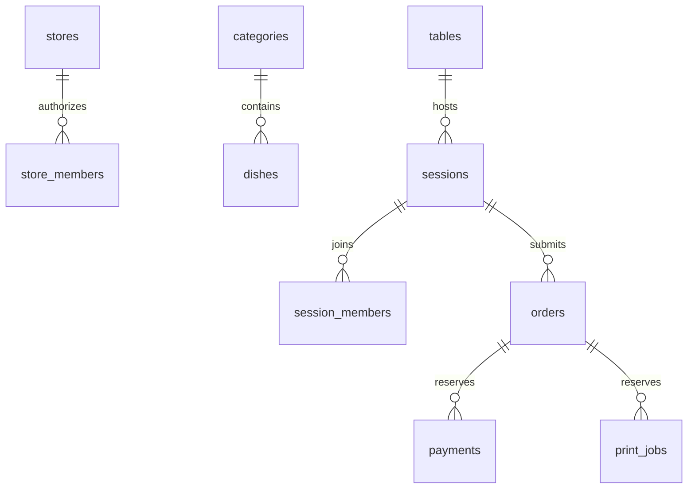

# 单门店云端模型 v2

环境 cloud1-d0g5igvuk85096f8a，AppID wx7dc3e02ff34b0133，固定 storeId=charcoal-demo。当前业务使用微信云开发；restaurant 处理菜单、配置与订单，table-service 处理桌码和用餐会话，identity 校验现有店主和员工。provision 仅允许店主初始化已列明集合与菜单，不接受任意数据库操作。

类型见 database/model.ts，索引见 database/collections.json。金额均为整数分；时间为服务端 epoch 毫秒；营业日按 UTC+8 计算。数据库所有集合 read=false/write=false，顾客及商家通过鉴权云函数访问。可信身份来自微信 OPENID/APPID，客户端传入的角色、身份和价格不作凭据。现有身份记录保留，初始化只补缺失配置。

| 集合 | 用途与关联 |
|---|---|
| stores | 当前门店名称、营业状态、欢迎词、餐具及餐巾纸单价 |
| store_members | 店主/员工授权；storeId+appId+openid 唯一 |
| categories | 分区、排序、上下架、软删除 |
| dishes | 分区引用、菜品、整数分价格、云存储 fileID、售罄、上下架、排序和版本 |
| tables | 固定桌号、桌码令牌哈希、正式码图片、当前 session 指针 |
| sessions | 每次用餐独立会话；人数及餐具/纸巾数量、费用快照、首单收费标记、未完成/未结算订单 ID |
| session_members | 当前会话与微信身份关联；会话关闭后资格失效 |
| carts | 共享购物车预留；本版购物车仍保存在顾客设备，不同步加购操作 |
| orders | 云端订单、桌号和菜品价格快照、餐具费用、状态、版本、请求幂等信息 |
| catalog_meta | 单店目录版本，菜单编辑与下单的事务一致性锁 |
| printers | 打印偏好配置；尚无真实打印服务 |
| payments | 真实支付流水预留；本版不写入虚假支付流水 |
| print_jobs | 打印任务及去重预留；本版不派发真实打印任务 |

扫码验证随机令牌哈希后，事务创建或加入本桌 open 会话，并写入成员资格。固定正式桌码跨用餐复用，每次结束用餐后下一批顾客获得新会话。旧会话不能提交新订单。二维码保存、预览和重复生成不会换码；删除桌台后旧码失效。

下单只提交 dishId、flavor、quantity、备注和扫码会话。云函数在同一事务内检查门店、桌台指针、会话成员、分区、菜品上下架和售罄，读取云端单价生成快照。餐具 1元/套、餐巾纸 1元/包为初始设置，商家可修改；确认时校验展示单价仍与云端一致。本次用餐的费用随首单计入一次，加单不重复。首单取消会释放收费标记。

订单 ID = SHA256(可信 OPENID + requestId)，submittedBy+requestId 唯一。超时重试保留 requestId，已经提交的请求返回原单；请求内容变化则拒绝。事务只做文档读取与写入；菜单编辑前的集合查询由 catalog_meta 版本锁保护。所有订单写入同时更新 session，关桌与下单互斥。

顾客读取自己提交的订单，商家可读全店订单，页面显示时每 5 秒刷新。状态为 pending→accepted→completed；未完成订单可按权限取消，商家操作校验版本。模拟付款只设置 demoPaid，不把 paymentStatus 改为真实 paid，也不写 payments。真实微信支付及退款尚未接入。

关桌读取会话的 unsettledOrderIds：订单取消，或完成且已模拟付款/真实结算后移出清单。清单非空不能关桌；关桌后立即撤销会话权限。购物车本机内容不会冒充云端订单，本机旧演示订单保留在设备并且不迁入云端。

初始化包含 8 个分区、54 个菜单项目及对应图片；肉类前四项顺序为羊肉、牛肉、猪肉、带皮五花肉。52张菜品图为生成图片，另2张保留原饮料图。初始化可重试且跳过已有记录，避免覆盖商家后续修改。

验证范围：本地服务逻辑测试覆盖可信身份、伪造价格、重复请求、会话隔离、状态版本、关桌与费用。真实云端验收记录另见 docs/cloud-deployment.md；两台真实手机的同时操作、真实支付和硬件打印不在已验证范围内。
